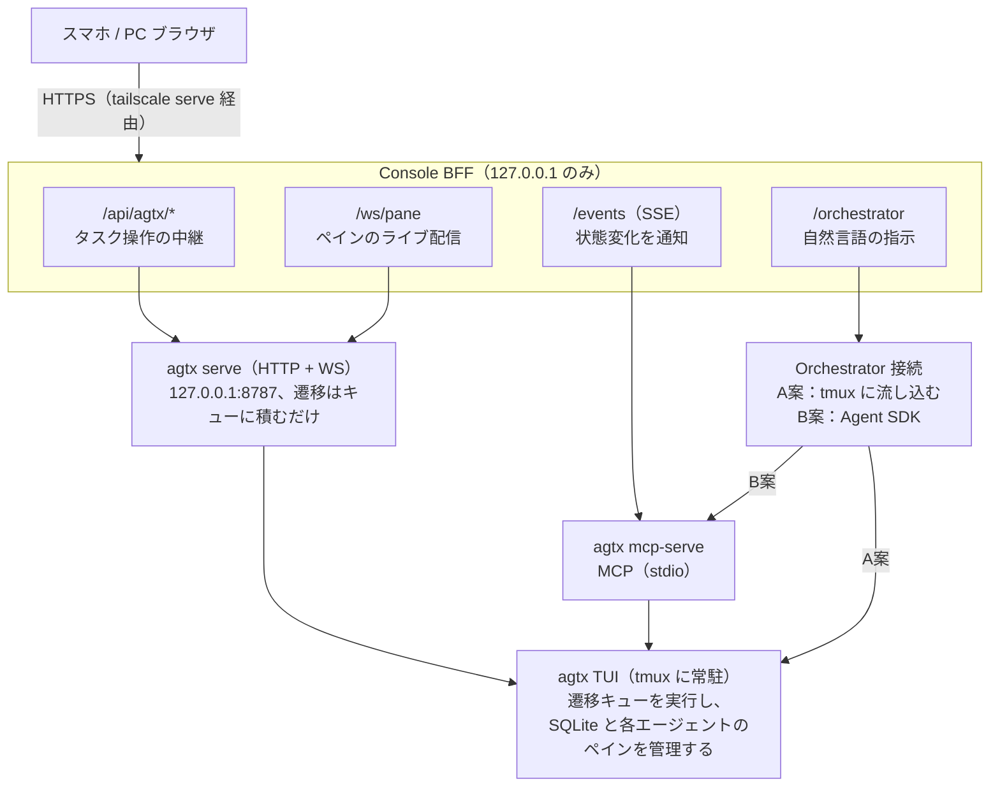

# agtx Webコンソール構想：Orchestrator連携 A案・B案 比較

2026-10-19 時点

## 背景と前提

agtx 1.0.6 を自然言語で指示できる Webコンソールから操作し、将来的にはスマホからも使えるようにしたい。ただし agtx 本体には Orchestrator への指示 API がないため、その部分はコンソール側で作る必要がある。本書では作り方の 2 案（A案・B案）と、それぞれに合う UI 案を比較する。

### agtx が外部に提供している連携手段

| 手段 | 起動 | できること | 備考 |
| --- | --- | --- | --- |
| MCP | `agtx mcp-serve <project>`（stdio） | タスクの一覧・作成・更新・削除、`move_task`、`read_pane_content`、`send_to_task`、`wait_for_board_change` | エージェント向けに定義されたツール群。仕様が最も安定していると見られる |
| HTTP + WebSocket | `agtx serve`（既定 127.0.0.1:8787） | タスク CRUD、`/action`、`/input`、`/pane`、`/diff`、`/ws`（ペインのライブ配信） | 内蔵スマホ UI が使う API。CORS ヘッダはなく、同一オリジン前提 |
| tmux | `agtx-playground:orchestrator` など | ペインへの文字入力、画面の取得 | agtx の API ではない。window 名の規則に依存する |

### 共通の制約

- フェーズ遷移（`move_task`、`/action`）はキューに積まれ、実行するのは起動中の agtx TUI だけ。どちらの案でも **TUI を tmux 上に常駐させる**のが前提。
- Backlog タスクの作成・編集・削除は、TUI がなくても即時に反映される。
- Orchestrator 用の HTTP エンドポイントはない（`/api/projects/{pid}/orchestrator` は 404）。
- 2026-10-19 に `agtx serve` を loopback で起動し、GET リクエストだけで確認した。書き込み系の API は試していない。

## A案：既存 Orchestrator のペインに流し込む

TUI が起動した既存の Orchestrator（tmux window `orchestrator` で動く Claude Code）をそのまま使う。コンソールは、入力された文章をそのペインに打ち込み、画面を読み取って表示するだけの「リモコン」になる。

### 仕組み

1. コンソールで指示を入力する（例：「レビュー待ちのタスクを全部 Done にして」）。
2. バックエンドが `tmux send-keys -t agtx-playground:orchestrator -l "<指示>"` を実行し、続けて `Enter` を送る。
3. Orchestrator は自分の agtx MCP（`agtx-orchestrator`）でタスクを操作する。
4. バックエンドは `tmux capture-pane -p -e` で画面を約 1 秒ごとに取り、WebSocket でブラウザに配信する（agtx serve の `/ws` と同じやり方）。
5. タスクの一覧・詳細・ペインは agtx serve の HTTP/WS を中継して表示する。

### メリット・デメリット

| | 内容 |
| --- | --- |
| メリット | 実装が小さい。バックエンドに AI のロジックを持たない |
| メリット | TUI での操作とコンソールでの操作が同じ Orchestrator に集約され、二重に遷移させる心配がない |
| メリット | agtx が更新した Orchestrator のスキルや挙動をそのまま使える |
| メリット | Claude Code のサブスクリプション内で動き、API 課金が増えない |
| デメリット | 返答がターミナル画面のテキストで、どこからどこまでが「今の返答」かを機械的に切り出せない |
| デメリット | 入力欄の補完ピッカーや許可プロンプトと衝突しうる。agtx が通知を流し込むタイミングとも重なりうる |
| デメリット | window 名 `orchestrator` と tmux の内部に依存し、agtx の公式 API ではない |
| デメリット | 「処理中」「完了」「どのツールを呼んだか」を UI で正確に示せない |

## B案：コンソールに独自の Orchestrator を持たせる

コンソールのバックエンドで Claude Agent SDK を動かし、`agtx mcp-serve` を MCP サーバとして接続する。自然言語の指示を受けた Claude が agtx のツールを呼び、その経過と返答を構造化されたデータとして UI に流す。

### 仕組み

1. コンソールのチャット欄で指示を入力する。
2. バックエンドが Agent SDK のセッションに渡す。使えるツールは agtx MCP（`list_tasks`、`create_task`、`move_task`、`send_to_task`、`read_pane_content` など）に絞る。
3. 返答のテキスト、ツール呼び出し、結果を 1 件ずつイベントとしてブラウザにストリーミングする。
4. 別のループで `wait_for_board_change` を呼び続け、フェーズ完了や承認待ちを検知する。自動で進めるルールがあれば Orchestrator に伝え、なければユーザーに通知する。
5. 会話履歴とセッション ID はバックエンドに保存し、スマホと PC で同じ会話を続けられるようにする。

### メリット・デメリット

| | 内容 |
| --- | --- |
| メリット | 返答が構造化され、普通のチャット UI として表示できる。「どのタスクを動かしたか」をカードで見せられる |
| メリット | 使えるツール、自動で進めるルール、確認が必要な操作（例：`move_to_done`）をコンソール側で決められる |
| メリット | 公式の MCP ツールだけを使うので、agtx の更新に強い |
| メリット | スマホ向けの通知や「全タスクの要約」など、agtx にない機能を足しやすい |
| デメリット | 実装量が大きい（セッション管理、ストリーミング、イベントループ、権限制御） |
| デメリット | TUI の Orchestrator と同時に動かすと、同じタスクを二重に進める恐れがある。どちらか一方に寄せる運用ルールが必要 |
| デメリット | Agent SDK の認証と課金を決める必要がある（API キーなら従量課金） |
| デメリット | agtx 付属の Orchestrator スキルが更新されても自動では反映されない。プロンプトを自分で保守する |

## UI案

A案には「ターミナル埋め込み型」、B案には「チャット＋ボード型」が合う。どちらも PC では 2 カラム、スマホでは下部タブで画面を切り替える構成にする。

```
UI-A：ターミナル埋め込み型                UI-B：チャット＋ボード型
┌─────────────────────────────────┐      ┌─────────────────────────────────┐
│ ボード      │ Orchestrator ターミナル│      │ チャット            │ 要対応     │
│ ┌────────┐ │ ┌──────────────────┐ │      │      ┌────────────┐ │ ┏━━━━━━━━┓ │
│ │設計·ready│ │ │> Review を全部   │ │      │      │Review を   │ │ ┃UI·blocked┃ │
│ └────────┘ │ │  Done に         │ │      │      │Done に     │ │ ┗━━━━━━━━┛ │
│ ┌────────┐ │ │● move_task × 2   │ │      │      └────────────┘ │ ┏━━━━━━━━┓ │
│ │API·working││ │完了しました      │ │      │ ┌──────────────┐    │ ┃設計·ready┃ │
│ └────────┘ │ └──────────────────┘ │      │ │2 件を Done に │    │ ┗━━━━━━━━┛ │
│ ┏━━━━━━━━┓ │ [y][n][1][2][Esc][^C]│      │ └──────────────┘    │ ───────── │
│ ┃UI·blocked┃│                      │      │ ┌──────────────────┐ │ ボード     │
│ ┗━━━━━━━━┛ │                      │      │ │move_task × 2     │ │ ┌────────┐ │
│ ┌────────┐ │                      │      │ │承認待ち：        │ │ │API·working│
│ │テスト·idle│ │                      │      │ │move_to_done      │ │ └────────┘ │
│ └────────┘ │ ┌──────────────────┐ │      │ └──────────────────┘ │ ┌────────┐ │
│            │ │指示を入力…       │ │      │ [承認] [却下]        │ │テスト·idle│
│            │ └──────────────────┘ │      │ ┌──────────────────┐ │ └────────┘ │
│            │                      │      │ │指示を入力…       │ │            │
└─────────────────────────────────┘      └─────────────────────────────────┘
```

太枠（┏━┓）のカードは対応が必要なタスク（blocked、ready）。UI-A ではボードの中に紛れるが、UI-B では「要対応」として上にまとめる。

### UI-A：ターミナル埋め込み型（A案向け）

- **左：ボード**。Backlog / Planning / Running / Review / Done の 5 列。カードに `phase_status`（working / blocked / ready）のバッジを付ける。
- **右：Orchestrator ターミナル**。tmux の画面を ANSI 色付きでそのまま表示し、下に入力欄を置く。
- **キーチップ**：`y` / `n` / `1` / `2` / `Enter` / `Esc` / `^C`。許可プロンプトにスマホから答えるためのもの（agtx serve の内蔵 UI と同じ考え方）。
- タスクを選ぶと、右側がそのタスクのエージェントのペインに切り替わる。

### UI-B：チャット＋ボード型（B案向け）

- **左：チャット**。吹き出し形式の会話。Orchestrator のツール実行は「`move_task` → タスク名 → 結果」のカードで表示する。
- **右：ボード＋要対応キュー**。承認待ち（blocked）、フェーズ完了（ready）、エスカレーションを上部にまとめ、「承認」「進める」ボタンで対応できるようにする。
- **確認ダイアログ**：Orchestrator が `move_to_done` など影響の大きい操作をしようとしたら、UI で承認を求める。
- タスク詳細画面には、差分とエージェントのペイン（読み取り専用＋キーチップ）を並べる。

### メリット・デメリット

| | UI-A：ターミナル埋め込み型 | UI-B：チャット＋ボード型 |
| --- | --- | --- |
| メリット | 画面の部品が少なく作りやすい。TUI で見えているものがそのまま出るので、情報が欠けない | スマホで読みやすい。「今対応が必要なもの」が一目で分かり、タップだけで答えられる |
| メリット | 許可プロンプトなど予想外の画面にも、キーチップでその場で対応できる | 会話履歴が残り、「いつ何を指示したか」を後から追える |
| デメリット | スマホの狭い画面ではターミナルの文字が小さく、折り返しで崩れやすい | 画面の種類が多く、デザインと実装の量が大きい |
| デメリット | 履歴は画面のスクロールバックだけで、検索や要約ができない | ペインの生の画面は詳細画面まで開かないと見えない |

UI-A は B案でも「ペイン表示」として使えるので、UI-A の部品はどちらの案でも無駄にならない。

## A案とB案の比較

早く動かすなら A案、スマホでの使い勝手と agtx 更新への強さを重視するなら B案が有利。実装の見積もりは、一人で Claude Code を使って作る前提の目安。

| 観点 | A案：既存 Orchestrator に流し込む | B案：独自 Orchestrator（Agent SDK） |
| --- | --- | --- |
| 実装量 | 小（tmux 中継と画面配信。数日程度） | 中〜大（セッション管理、ストリーミング、イベントループ。数週間程度） |
| 返答の形 | ターミナル画面のテキスト | メッセージとツール実行の構造化データ |
| スマホでの使い勝手 | 低い（小さい画面にターミナルを表示） | 高い（チャットとボタン） |
| 入力の確実さ | 低い（補完ピッカー、許可プロンプト、agtx の通知と衝突しうる） | 高い（API で直接渡す） |
| agtx 更新への強さ | 中（tmux の window 名に依存。Orchestrator の改善は自動で取り込める） | 高（公式の MCP ツールのみ。ただしプロンプトは自分で保守） |
| 二重操作のリスク | なし（Orchestrator は 1 つ） | あり（TUI の Orchestrator を止める運用が必要） |
| 利用料金 | Claude Code のサブスクリプション内 | 認証方式次第。API キーなら従量課金 |
| 安全制御 | Orchestrator の設定に任せるしかない | 使えるツールを絞り、重い操作に承認を挟める |
| 状態の可視化 | 「処理中」「完了」を画面から推測する | イベントで正確に分かる |
| 合う UI | UI-A：ターミナル埋め込み型 | UI-B：チャット＋ボード型 |

実装日数は目安であり、詳細な見積もりは計画フェーズで行う。

## 共通の基盤とリモート接続

A案・B案のどちらでも、コンソールのバックエンド（BFF）を 1 つ置き、127.0.0.1 にだけバインドする。両案で違うのは Orchestrator とのつなぎ方だけなので、その部分は差し替えられるようにアダプタとして切り出す。



A案では BFF が tmux の orchestrator window に文字を送る。B案では BFF の中の Agent SDK が agtx mcp-serve を通してタスクを操作する。どちらの案でも、遷移を実際に実行するのは TUI。

### BFF の役割

| エンドポイント | 接続先 | 用途 |
| --- | --- | --- |
| `/api/agtx/*` | agtx serve（127.0.0.1:8787）への中継 | タスクの一覧・詳細・差分・遷移・ペイン入力 |
| `/ws/pane` | agtx serve `/ws` への中継 | タスクペインのライブ配信 |
| `/events`（SSE） | MCP `wait_for_board_change` のループ | 状態変化、承認待ち、フェーズ完了の通知 |
| `/orchestrator` | A案：tmux の `orchestrator` window、B案：Agent SDK + agtx MCP | 自然言語の指示と返答 |

- 同じオリジンから中継するので、agtx serve に CORS ヘッダがない問題を回避できる。
- HTTP 側のプロジェクト ID は UUID、MCP 側は `agtx-playground` なので、BFF で対応表を持つ。

### リモート接続（スマホ）

- **推奨：Tailscale の `tailscale serve` で BFF だけを公開する**。自分の tailnet に入った端末だけが HTTPS で接続でき、agtx serve 自身は loopback のままにできる。
- インターネットへ公開する場合（cloudflared、`tailscale funnel`）は、BFF に独自の認証が必須。ペイン入力と Orchestrator への指示は、実質的に遠隔からコードを実行できる権限だから。
- 参考：agtx serve 自体にも、端末ごとのペアリング（QR コード → 端末ごとのトークン、`--revoke` で無効化）と `--tunnel` オプションがある。BFF の認証を作るときの手本になる。
- 通知をスマホに届けるには、PWA の Web Push（HTTPS 必須）か、ntfy など外部の通知サービスが必要。

## 推奨と進め方

最終形は **B案 ＋ UI-B** を推奨する。ただし、共通基盤と A案を先に作り、使いながら B案に移る。A案で作ったペイン表示とキーチップは B案でもそのまま使える。

1. **内蔵 UI を試す**：TUI で `W` キー、または `agtx serve`。足りない点を書き出す。
2. **共通基盤**：BFF、agtx serve の中継、`/events`、ボードとタスク詳細の画面。
3. **A案＋UI-A**：Orchestrator ターミナルと入力欄。自然言語での指示がここで使えるようになる。
4. **リモート接続**：`tailscale serve` でスマホからつなぐ。
5. **B案＋UI-B**：Agent SDK の Orchestrator、チャット、要対応キュー。この段階で TUI の Orchestrator は止める。

### 未決事項

- [ ] 最終的に B案へ移るか、A案のまま運用するか
- [ ] B案での Claude の認証方式（API キーか、サブスクリプションか）と課金の上限
- [ ] リモートの範囲：tailnet 限定でよいか
- [ ] agtx TUI を tmux に常駐させる運用でよいか
- [ ] 未検証：MCP の global mode の起動方法、`wait_for_board_change` の返却形式、`POST /action` のレスポンス
- [ ] github.com/fynnfluegge/agtx に API の安定性方針があるか
